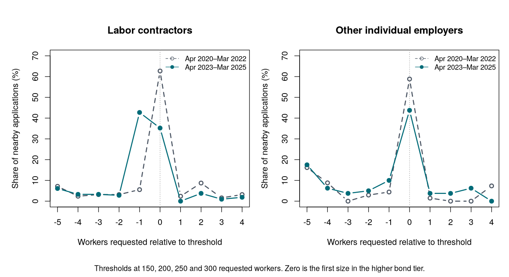

# Research directions for the 2008–2025 H-2A records

**For broad coverage, build the historical chapter around how existing filing organizations expanded H-2A use across all 50 states.** Among filers present in consecutive years, increased numbers of positive certification cases accounted for 96% of net growth over FY2008–25. About 90% of their growth occurred in states they already served. For a wage-centered paper, year-round posted-wage comparisons cover 3.34 million positions, or 88.6% of national reconciled certified capacity. The contractor bond thresholds, Washington piece rates and occupational reclassification are narrower mechanism studies. [National coverage, priorities and four empirical comparisons](coverage/README.md)

These exploratory analyses use outcome years through 2025. The original shared calendar-year panel could include a later decision on a 2025 start, and the retained identity links could incorporate FY2026 Q3 evidence. The fiscal-cohort calculations use the named fiscal years. On November 21, 2026, Gemini Carbon (High) and Neon (XHigh) each returned an independent review. We checked all twelve proposals against the repository and ran follow-up analyses of filing sizes, wages, form language and potential sources of historical variation. [Reviews, new results and material disagreements](reviews/README.md)

## 1. A policy result with a visible quantity margin

The 2022 rule introduced a step in a labor contractor's surety obligation at 150 requested H-2A workers, then at 200, 250 and every subsequent multiple of 50. Requesting 149 instead of 150 could therefore preserve almost the entire crew while avoiding an additional bond obligation. The comparison group uses other individual-employer applications, which also tend to request round numbers. The outcome is the number requested per application. A bond's face value and a firm's actual premium are different quantities. [Final rule and employer incentives](https://www.govinfo.gov/content/pkg/FR-2022-10-12/html/2022-20506.htm)

Among applications close to the first four new thresholds, the share of contractors requesting **exactly one worker below** rose from **7/126 (5.6%) to 91/213 (42.7%)**. The same share rose from 3/68 to 8/80 among other employers. The difference in changes is **+31.6 percentage points** (exploratory filer-clustered 95% interval +19.4 to +43.7). Using the much broader set of all applications for 100–349 workers gives +9.5 points. Round-number heaping is visible throughout, and an exact-one-below placebo at intermediate sizes moves −12.7 points. A broader five-size measure already exhibited a substantial pre-period movement. Those checks make the extra mass specifically at the last worker before the statutory step more interesting than a generic shift toward smaller applications. [Integer distribution and full tests](policy/README.md)

Three different tests address the economic interpretation.

- **Did contractors put residual workers on another application?** Among 124 late contractor applications one to five workers below a step, 51 had a same-filer, same-state, same-start-day companion. Fifteen had a small companion that could take the combined crew over the step. Only one focal case still had such a companion after requiring matching city and occupation, close receipt dates and certification on both files. Combining all eligible requests at a filer, state and start day leaves a +25.1-point five-size contrast, compared with +26.6 points by application. A companion at another client or site remains possible. [Companion audit](packaging/README.md)
- **Did they report needing an additional worker on the same form?** For 78 of the 91 late just-below cases, total workers needed equaled H-2A workers requested. Twelve reported total need at or above the step. This supports a claim about reported crew size. It cannot establish replacement by domestic workers or a change in actual employment. [Declared staffing fields](policy/README.md)
- **Did total program use decline?** Fix contractor groups by maximum application size before the rule and keep filers who later disappear at zero. Higher-exposure filers' all-role request volume changed by −5.2% relative to the comparison group, with an approximate interval of −23.4% to +17.4%. The first-to-second early-year contrast was already −4.6%. The sample has 78 and 64 baseline filers. An aggregate hiring or demand claim would reach well beyond the evidence. [Quantity pilot](policy/README.md)

Prior research already establishes that contractors account for a substantial share of H-2A jobs. This project can add the links between filing organizations and worksites, and the change in the exact sizes of applications at a legal threshold. The historical contractor share alone would have less to add. [Simnitt and Castillo, 2025](https://doi.org/10.1002/aepp.13534)

## 2. An AEWR-centered paper with a measurable outcome

| Historical test | Result | Interpretation |
| --- | --- | --- |
| Annual schedule resets, 2015–24 | The share of hourly offers at the new reference rose from 17.2% in the 56 days before effectiveness to 95.8% in the 56 days beginning on the effective date. An artificial rate seven cents away rarely matched. | Posted offers closely track the applicable regional reference in the screened group. Anticipation and the administrative timing of the recorded offer preclude treating the date as a surprise discontinuity. [Annual resets](policy/README.md) |
| Hold the filer, state, SOC and update fixed | Across 2,110 cells filing on both sides, equal-cell match rates rose from 17.9% to 97.8%. After rises, 97.5% of all screened offers matched. After falls, 76.7% did. | Changing employer mix cannot explain the full reset. Downward revisions have thinner support, and continuing contracts, competing floors and job mix need separate checks. [Direction and repeat-filer tests](policy/README.md) |
| Reclassification around the March 2023 occupation rule | Of 49 continuing filer–state–title cells switching out of the six common field occupations, 28 moved from agricultural equipment operator to heavy truck driver. Forty of 49 posted a wage close to the destination SOC reference. The median wage increase was $7.75, versus $0.96 for stable field cells. | The forms show an expensive classification margin. Possible changes in tasks and the certifying agency's role prevent attributing the decision to employer intent. A switch **into** the six occupations occurred in 13.3% of eligible cells versus 13.5% in the preceding placebo. [Occupation and requirements checks](occupations/README.md) |
| Predetermined contract timing × regional AEWR innovation | For a 25-point difference in the baseline share of already-certified capacity and a 0.05 log-point larger wage innovation, next-FY certified hours differed by −0.64% (95% interval −3.76% to +2.58%). The earlier-outcome placebo was −1.21%. Florida accounted for 42.6% of identifying variation. Omitting it gave +1.07%. | 1,993 counties and 15,944 rows supplied the equivalent of only 3.78 equally informative regions. The realized 80%-power detectable increase was approximately 4.56% for this contrast. These figures concern differential timing exposure. They do not recover an overall demand elasticity. [Model, power calculation and all region deletions](commitments/README.md) |

The trucking comparison offers another historical outcome. Among 2,176 recurring equipment-operator cells that kept their occupation code and had usable text in both seasons, trucking-related terms in additional requirements fell from 30.2% to 2.8% of cases on average. The corresponding earlier placebo was 24.9% to 24.8%. Among the 28 equipment-to-truck switchers, 23 already mentioned trucking in every observed text in both seasons. A study of how the rule changed **what duties were advertised and how jobs were priced** can build on both groups. Boilerplate, negation, changes to form fields and movement into attachments are important alternatives to real task changes. [Earlier and later placebos, text coverage and coding](occupations/README.md)

We also tested whether pre-rule trucking language predicted **subsequent program use**, keeping absent filers at zero and following later requests across all titles and occupation codes. For January–February 2023 equipment-operator filers, the January–February 2024 ratio of requests to baseline was 0.597 for the trucking-language group and 0.821 for other equipment filers after reweighting within states. The difference was −22.5 percentage points (state-deletion interval −56.0 to +11.1). Matching on filing agent gave a similar point estimate. Restricting outcomes to the original titles reduced it to −7.3 points, and the median offer among returning filers increased by $0.99 in both groups. The probability of filing again in the same two-month season fell by 6.9 points relative to controls in 2024 (interval −11.5 to −2.2), compared with +0.3 points in the pre-rule placebo and −0.1 points in 2025. The probability of a heavy-truck filing rose by 3.8 points (interval +1.5 to +6.1). Counting requests over the full March–February year gives −12.9 points (interval −38.3 to +12.5). This combination makes short-run filing timing and occupation choice better candidates for follow-up than permanent exit. Text predicted a change in some recorded classifications. The corresponding quantity and price results do not support a wage elasticity. [Fixed-cohort tests and independent baseline placebo](occupations/README.md)

The older screening exercise already found weak conversion from within-state exposure to wages, too little residual variation in the 2009/10 and 2023 designs, and imprecision once common shocks were allowed. The retained moving-wage IV has a strong numerical first stage, yet its wage calibration, regional assignment and farm-income diagnostic complicate interpretation. Pooling the wage-reset matches with these usage designs would mix outcomes, units and assumptions. [Historical design search](../../markdowns/identification_search_report.md) · [Retained IV results](../../markdowns/panel_iv_estimation_report.md)

## 3. What the full historical record contributes

**Who expanded?** In the five annual transitions from FY2020 to FY2025, consecutive-year filers supplied 88,447 of 122,649 net additional reconciled positions, or 72.1%. Their comparable share in FY2011–19 was 52.7%. On identical records with named worksites in the later period, continuing filers supplied 72.1% of growth. Continuing worksite businesses supplied 41.2%, rising to 58.7% with looser linkage. The same organization can return while the clients or businesses it names change. A continuing filer is classified anew in each pair of years. [Growth accounts, relationship flows and linkage checks](business/README.md)

**Where did expansion occur?** Counties with some recorded use in 2008–10 supplied 75.0% of net growth in allocated start-year positions through 2023–25. With a 2009–10 baseline, that share is 68.6%. It falls to 44.3% when the entire analysis is restricted to cases unambiguously located in one county. Fully resolved single- and multi-county cases together account for only about one fifth of all net growth under the complete-case geography audit. Claims about true geographic consolidation would therefore be fragile. Neighboring counties' prior use improved the held-out ranking of which county would first reach ten positions (AUC 0.664 to 0.694). Shared crops, weather, reporting changes and common filers can all produce proximity. [Geographic accounting and forecast tests](geography/README.md)

**When were the workers requested?** Freeze each county's peak crop-employment month from public QCEW in 2003–07, before observing later H-2A activity. Among 487 measurable counties with zero matched capacity throughout 2009–11, 460 had capacity in at least one of the four reference months by 2022–24. Their old peak month accounted for 36.6% of later four-month capacity versus 33.8% if peak months were exchanged within state and historical crop-employment size group. This is evidence that expansion followed pre-existing crop calendars. It is also a reason to be skeptical of using seasonality as an excluded instrument for labor demand. [Crop calendar, duration and coverage](calendar/README.md)

**Which parts of the historical series are comparable?** The FY2008 local reconciled total exceeds OFLC's published positions certified by 8,068. Of this excess, 8,024 is already present in certified-status raw master rows. Later benchmark years agree much more closely. FY2020 changed which worksite businesses appear in the disclosures, and current historical identity links can use later evidence. I would retain 2008 as evidence of prior presence, report the endpoint sensitivity, and use FY2011–19 and FY2020–25 for headline business comparisons. Position-days measure authorized contract capacity. Admissions, distinct people, days actually worked, wages paid and the decision of a farm that never applied require different evidence. [Endpoint audit and published totals](business/README.md) · [Worksite calendar contract](../../content/contracts/h2a-worksite-exposure.md)

## 4. Further designs worth distinguishing

These are proposals beyond the executed tests above. Each has a specific observation that would reduce the case for pursuing it.

| Question | Empirical comparison | What would settle whether to proceed |
| --- | --- | --- |
| Did the bond change what an existing client requested? | Fix pre-rule contractor–client relationships and compare the same site's requests, total declared need and weeks across seasons. Audit a sample of 149/150 job orders against client, overlap dates and occupation. | The proposed client-level estimand needs defensible links to the same underlying work. Similar dates alone have already produced many spurious companions. |
| Did requests move to other firms rather than disappear? | In the same historical county and crop season, decompose losses by baseline large contractors into changes at smaller contractors, direct filers and total market capacity. | Establish similar changes in placebo markets before the rule. Suppress market-level conclusions where ambiguous geography drives the difference. |
| Did the bond change contract length as well as size? | For recurring titles or clients, compare inclusive duration and certified position-days at newly introduced steps, old steps and intermediate round sizes. | A stable number of position-days alongside smaller forms would support rescheduling. A changing mix of dates or clients can mimic it. |
| Were credit constraints important? | Use observed bond premiums, collateral requirements or bond documents linked to case IDs if publicly obtainable. Compare the statutory change with the change in financing terms. | Without observed cost or defensible external terms, report response to a coverage requirement and leave its dollar elasticity unidentified. |
| When did employers learn the next AEWR? | Align archived first-published FLS rates, notices, job-order submission, receipt and disposition for the same renewals. Compare offers submitted before either publication and those in the information window. | If only final amended offers exist, study the recording process. A receipt-date event study alone cannot establish learning or anticipation. |
| Are wage decreases transmitted less often? | Fix the returning job and distinguish new contracts from already guaranteed offers. Compare raises and cuts of similar size, with state minimum-wage and occupation checks. | The raw 97.5% versus 76.7% gap could disappear once floors and renewal cohorts match. A handful of regional declines bounds precision. |
| Did task content or administrative classification change? | Blind-code identical-title pre/post job orders for license class, vehicle weight, public-road hauling and duties. Compare the 28 equipment-to-truck switches with stable equipment and truck jobs. | The requirements extraction already finds trucking language in both periods for most switchers. Only consistently recorded job duties or dated corrections could distinguish repricing existing tasks from a real change of job. |
| Do established filers carry the program into new places? | Among first recorded county crossings, distinguish a filer already serving a neighboring county from one entering the broader market for the first time. Compare equally close counties sharing crop mix. | A geographic signal restricted to imputed sites or disappearing under the filer or geography sensitivity would weaken a network interpretation. |
| Does experience increase repeat program use? | Compare recurring filers and named client businesses around first observed participation after a fixed washout. Measure return after one, two and three years, with fixed follow-up and separate pre-/post-2020 periods. | Identity-sensitive exits and pre-2008 users relabeled as entrants prevent interpretation as learning-by-doing. Cohort durability itself remains measurable. |
| Does H-2A meet peak shortages or extend the season? | Use the predetermined QCEW peaks, public crop acreage and local calendars to partition new certification days into peak, shoulder and winter periods within the same crop geography. | Declared capacity can establish timing. A displacement or shortage interpretation additionally needs independent outcomes with verified H-2A coverage. |
| Can the history sharpen assessment of a specific reform? | Set a forecast using only earlier years, validate it on complete historical pseudo-events, then measure a declared policy-period forecast error in the same units. Compare against a seasonal naïve forecast. | Poor calibration or common errors across regions defeat a claim of gained power. Even perfect predictions do not randomize a national policy. |

Under a broad-coverage priority, the national filer expansion and annual posted-wage results take precedence. Two additional nationwide pilots examine nonfarm employment competition and growing conditions. Their geographic reach is strong, but concentrated shocks and timing checks limit the conclusions on H-2A quantities. The paired records at the bond steps and around occupation changes can illustrate mechanisms in an appendix. [Coverage and empirical results](coverage/README.md)

## Reproduction

Each linked branch README gives the exact R commands, inputs, sample definitions and checks. Run from the repository root using the project R library. The exploratory scripts consume cached inputs. Production designs and manuscript tables retain their existing specifications. The numerical comparisons above are exploratory, with follow-up specifications developed after inspecting related results.
