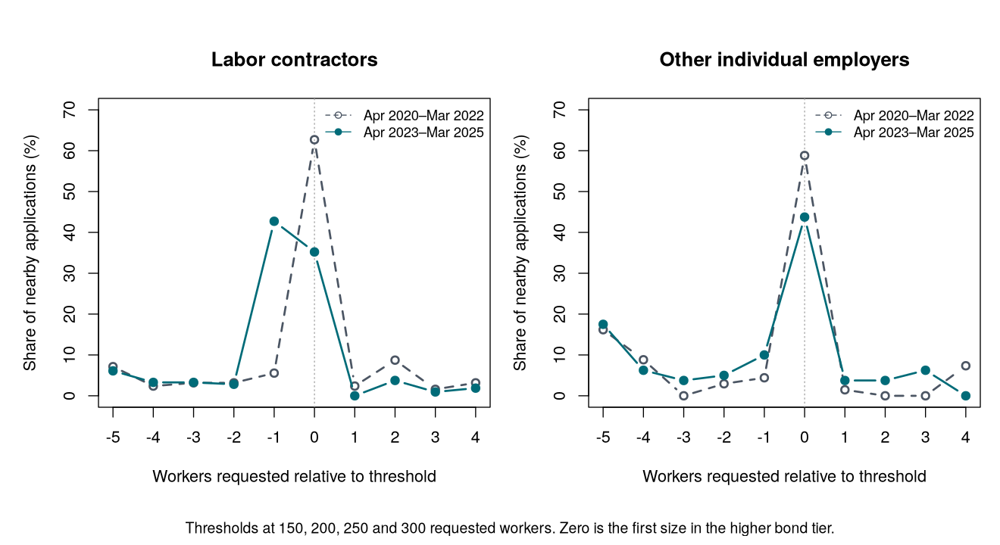

# Contractor application sizes and historical wage offers

## An additional bond for the 150th worker

The 2010 schedule ended at the 100-worker tier. The 2022 final rule added a bond increment for every full 50 H-2A workers above 100 per certification. In 2023, for example, moving from 149 to 150 requested workers increased required coverage by $64,520. The contractor pays a premium and may face collateral or credit constraints. The coverage amount is not the contractor’s cash cost. Earlier tiers also became more expensive. [2022 final rule](https://www.govinfo.gov/content/pkg/FR-2022-10-12/html/2022-20506.htm) · [DOL calculation examples, questions 14–15](https://www.dol.gov/sites/dolgov/files/ETA/oflc/pdfs/2022%20H-2A%20FR_FAQs%20Round%206_H-2A%20Labor%20Contractors%20-%208-3-23.pdf)

Compare applications received in April 2020–March 2022 and April 2023–March 2025. Both windows include two complete seasonal cycles, avoid the regulatory transition and allow the same 180 days for a decision. The sample uses unique unambiguous cases, all decision statuses, positive integer H-2A requests, the individual-employer application type and an explicit Y/N contractor flag. There are 5,114 contractor and 22,041 comparison applications in the early window and 7,489 and 38,787 in the late window. The H-2A request field and separate total-workers-needed field appear in every FY2020–25 disclosure workbook. The reliable flag limits the bond comparison to the later part of the project history. [DOL implementation guidance](https://www.dol.gov/sites/dolgov/files/ETA/oflc/pdfs/2022%20H-2A%20FR_FAQs%20Round%201_Implementation.pdf)

The first screen pooled applications from five sizes below through four sizes above each of 150, 200, 250 and 300. Equal-weight shares refer to applications in those bands. The exact one-worker check, inference and additional sensitivity checks followed inspection of the distribution.

| Share of nearby applications | Early contractors | Late contractors | Early other employers | Late other employers | Contractor change less comparison change |
| --- | ---: | ---: | ---: | ---: | ---: |
| Any of five sizes below | 27/126 (21.4%) | 124/213 (58.2%) | 22/68 (32.4%) | 34/80 (42.5%) | +26.6 pp |
| Exactly one worker below | 7/126 (5.6%) | 91/213 (42.7%) | 3/68 (4.4%) | 8/80 (10.0%) | +31.6 pp |
| Exactly at the step | 79/126 (62.7%) | 75/213 (35.2%) | 40/68 (58.8%) | 35/80 (43.8%) | −12.4 pp |



The five-size contrast has a filer-clustered 95% interval of +5.5 to +47.8 pp across 249 linked filers and 487 cases. It ranges from +20.7 to +33.1 pp when omitting one worksite state at a time. For the exact one-worker contrast, the filer-clustered interval is +19.4 to +43.7 pp, and the state-clustered interval is +16.5 to +46.6 pp. Across all 2,471 applications requesting 100–349 workers, the differential change in the share at exactly 149, 199, 249 or 299 is +9.5 pp (filer interval +6.0 to +13.0). Those denominators answer different questions. Beyond 300, just one of 27 early and four of 20 late nearby contractor cases are exactly one below a higher step. Support for that extension is thin.

**The placebo results depend on what is counted.** For the exact one-worker outcome, the difference in changes between the two early years is −2.7 pp (filer interval −16.9 to +11.4). For any of five sizes below, the corresponding early difference is already about +27 pp. At the non-step sizes 125, 175, 225 and 275, the five-size contrast is −1.3 pp, while the exact-one-below contrast is −12.7 pp. There is clear movement in the rest of the size distribution too. The older legal steps at 25–100 give a five-size contrast of −3.8 pp. Changes in clientele, crew-size rounding, differential trends, and the other provisions enacted with the rule remain possible explanations. Filer- or state-clustered intervals quantify sampling variability under those grouping choices. They do not create independent national policy changes or adjust for this exploration.

**What happened to the other worker?** Among the 91 late contractor cases exactly one below a step, 78 reported that same number for total workers needed, 12 reported total need at or above the step, and one reported an internally inconsistent lower total. Thus the very common exact-one-below declaration usually extended to both staffing fields. The companion-filing audit separately searches the same filer, state, start day, city and occupation. Reaggregating all eligible requests by filer, state and exact start date leaves a +25.1 pp five-size contrast. The two reported staffing fields and the linked applications still leave actual hiring unobserved. [Companion filings](../packaging/README.md)

A separate quantity pilot fixed groups using each contractor filer’s maximum request in April 2020–March 2021. It then counted all of their reported H-2A requests across application roles, keeping absent filers at zero. There were 78 baseline filers with maxima of 150–299 and 64 with 100–149. Relative to the second early year, the ratio of later average annual volume to early volume was 0.790 and 0.833 respectively. The relative change was **−5.2%**, with an approximate stratified delete-one-filer interval of **−23.4% to +17.4%**. The selection-year to second-year contrast was already −4.6%. Baseline size, differing survival and selection on a maximum defeat a straightforward causal interpretation. The better-supported finding concerns application sizing.

## How quickly did the annual AEWR appear in posted wages?

For the ten 2015–24 FLS reference updates, align applications by receipt date relative to effective date. Keep single-state, positive-certified, hourly jobs in the six common occupations, with a unique unambiguous disclosure for the case after excluding designated sub-rows. All recorded allocation states must agree with the disclosure. Keep positive hourly offers up to $100 with a decision within 180 days. Compare exact-to-the-cent matches to the new versus previous state reference on cases with a change in the reference. The ±7-cent comparison averages matches to two artificial rates. The calendar months represented in each window depend on the effective date. The 2009 regime, 2010 reversal, and split December 2024 dates for the 2025 reference lie outside the test.

| Receipt date relative to effective date | Cases | At new reference | At old reference | At ±7-cent comparison |
| --- | ---: | ---: | ---: | ---: |
| Days −168 to −113 | 6,509 | 0.02% | 94.91% | 0.49% |
| Days −112 to −57 | 9,807 | 0.03% | 97.05% | 0.53% |
| Days −56 to −1 | 26,995 | 17.21% | 79.68% | 0.19% |
| Days 0 to 55 | 36,219 | 95.82% | 1.34% | 0.01% |

In 2,110 filer–state–SOC–update cells observed on both sides, equal-cell exact matches rose from 17.9% to 97.8%. Giving equal weight to states observed in all four windows within each update, then equal weight to updates, yields 16.1% and 94.4%. Post-update matches were 97.5% for rises and 76.7% for falls. The falls come from 49 state-updates across just five annual updates. This asymmetry invites a same-job renewal and competing-floor analysis. It cannot yet be attributed to downward wage rigidity.

The effective date follows earlier information about rates. Sorting, shifts in cases near holidays, and wage fields recorded as of disposition can affect the time profile. A disclosed offer is neither a realized paycheck nor necessarily the offer as first filed. Later filings can quote the rule almost exactly while employers make very different quantity choices. A causal employment elasticity would need variation in exposure and an independent comparison for utilization. [Rate definitions](../../../content/contracts/aewr-inputs.md) · [Direct commitment and quantity test](../commitments/README.md)

## Reproduction

From the repository root:

```sh
source scripts/pipeline_helpers.sh
configure_r_library
Rscript --vanilla explorations/historical_usage/policy/bond_thresholds.R /tmp/h2a-history-policy
Rscript --vanilla explorations/historical_usage/policy/wage_resets.R /tmp/h2a-history-policy
```

The scripts read cached disclosures, allocated worksites, dated AEWRs and the retained R7 filer mapping. The bond script writes the full threshold, comparison, denominators, integer distribution, split-year and fixed-cohort tables and regenerates the plotted PNG in the supplied directory. The wage script writes state-by-update, direction and matched-cell tables. Outputs contain aggregate values only. These are exploratory specifications dated after the earlier identification search. The paper's production estimators use their own definitions.
